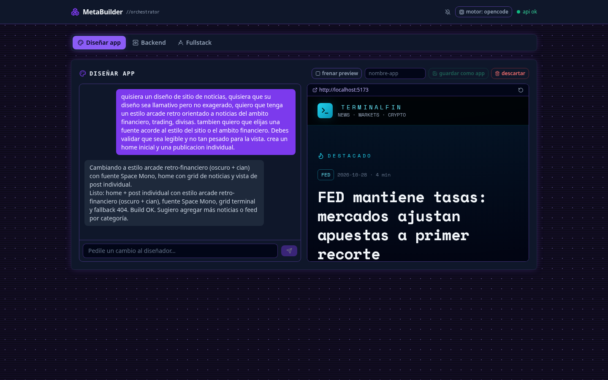

# MetaBuilder — Orquestador de desarrollo con agentes

*Desarrollado con [Devin](https://devin.ai) (ex Windsurf) utilizando el modelo SWE-2.*

MetaBuilder convierte una idea en texto libre en una aplicación funcionando (landing pages, webs de pedidos con carrito y WhatsApp, blogs, etc.) mediante un **harness multi-agente construido sobre LangGraph**: un orquestador determinístico coordina sub-agentes que escriben el código con **Devin CLI via ACP**. La arquitectura es **híbrida** — cada tarea la ejecuta el recurso más barato capaz de resolverla: código local para lo predecible (planes por vertical, copia del skeleton, validación del plan, verificaciones, git/README/deploy) y **sesiones Devin solo para lo generativo** (un builder por paso del plan, un fixer que recibe el stderr real del fallo, y un revisor QA que aprueba o rechaza la app terminada). Cada paso corre en su propia sesión aislada (sobre un proceso `devin acp` reutilizado por el run — initialize+authenticate una sola vez, `session/new` por paso) y el estado vive en `plan.json` + el filesystem, con lo que el pipeline puede reintentar, reanudar y pedir aprobación del plan antes de gastar una sola llamada al agente. Los beneficios: una app lista en ~5 minutos y pocas sesiones en lugar de un agente pesado por tarea; fallos acotados al paso que los causó con reparación dirigida; verificaciones reales (build + tests + e2e) como compuertas entre etapas; y un humano en el loop (plan → aprobar → construir) que evita desperdiciar trabajo en planes equivocados.



## Features

- **Generación end-to-end** — idea en texto libre → plan → builder por pasos → verify real (build + vitest + e2e) → QA reviewer → app lista.
- **Verticales determinísticos** — `landing`, `orders`, `blog` con plan instantáneo sin gastar sesiones de agente; `custom` con planner LLM.
- **Multi-engine** — los nodos generativos hablan ACP: [Devin](https://devin.ai) (`devin acp`) u [OpenCode](https://opencode.ai) (`opencode acp`) — se elige por run (`--agent`), por proyecto (`plan.agent`) o global (dashboard/`AGENT_PROVIDER`/`auto`).
- **Configurable** — scope (`frontend`/`backend`/`fullstack`), stack (`vite-react`/`nextjs`, `express-sqlite`/`express-postgres`/`express-mysql`/`express-mongo`) y arquitectura backend (`flat`/`mvc`/`layers`/`feature`).
- **Dashboard completo** — encolar y supervisar runs, feed en vivo del agente, terminal Devin embebida en la app, correr en dev sin containers, docker/podman, tests, eliminar y clonar proyectos, notificaciones al terminar.
- **Cola batch** — jobs con log propio, cancelación que mata el árbol, reintentar, progreso por pasos en vivo.
- **Resiliente** — resume desde `plan.json`, requeue de jobs fallidos, semáforo global de sesiones, process groups sin huérfanos.
- **Apps listas para producción** — Dockerfile por variante, request logging, uploads, tests unit+e2e, deploy a GitHub/Pages.
- **Tooling** — `npm run doctor` (prereqs), `validate:pr` (sub-agente que revisa PRs del repo), cola/worker por CLI.

## Cómo funciona

```
preflight → planner → validate ─┬─→ confirm → builder → verify ─┬─→ builder (siguiente paso)
                                │                               ├─→ finalVerify → review ─┬─→ finalize → END
                                └─→ repairPlan                  └─→ fixer → verify        └─→ fixer
```

| Nodo | Qué hace |
| --- | --- |
| `preflight` | Chequea binarios + auth Devin (ACP) en paralelo, crea `generated-apps/<slug>/`, copia `AGENTS.md` y los **skeletons**: `app-skeleton` (Vite+React+Tailwind+Vitest+Playwright) o `app-skeleton-next` (Next.js+React+Tailwind, según `--stack-frontend`) si el vertical tiene frontend, `api-skeleton` (Express 5 + SQLite + uploads con whitelist por extensión + auto-mount de routes + request logging `método url status ms` + `server/security.js` con headers y rate limit — hace útiles los `docker logs` y el dev run local) si el scope tiene backend, más el **overlay** del vertical (`schema.sql`/`seed-data.js`/`routes/`). Los skeletons traen `.github/workflows/ci.yml` (npm ci + audit + test). El install del toolchain (`npm install` en los stacks actuales) y el pre-warm de Playwright corren en background. |
| `planner` | Genera `plan.json`. Si `appType` es un **vertical conocido** (`landing`, `orders`, `blog`) usa un template determinístico (**sin llamar a Devin**); si es `custom`, una sesión Devin ACP lo escribe. Si ya existe `plan.json`, lo reutiliza (resume). |
| `validate` | Validación 100% local del plan (schema, tipos de paso, `verify` ejecutable, requisitos por scope + perfiles de cumplimiento de `plan.compliance` — `privacidad`/`notfound` siempre con frontend, más los inferidos por la idea o `--compliance`). |
| `confirm` | `interrupt()` de LangGraph: muestra el plan y espera `[S/n]` — solo en TTY y sin `--yes`. |
| `builder` | Una sesión Devin ACP por paso (`prompts/builder.md`). Pasos `infra` con skeleton ya copiado no consumen Devin. |
| `verify` | Corre el comando `verify` del paso dentro del proyecto (`execa`, nunca lanza). |
| `fixer` | Si verify falla: manda a Devin la descripción del paso + stderr (`prompts/fixer.md`). Máx `MAX_STEP_RETRIES` (3) intentos. |
| `finalVerify` | Batería por toolchain del stack: `npm run build` + `npx vitest run` + `npm run test:e2e` (solo si hay frontend; backend → solo vitest). |
| `review` | Sub-agente QA: sesión Devin revisa la app contra `AGENTS.md` y la idea (`prompts/reviewer.md`) — incluye checklist de seguridad/privacidad (`/privacidad`, consentimiento, sin XSS, prepared statements). `RESULT: APPROVED` → finalize; `RESULT: ISSUES` → fixer. |
| `finalize` | Genera `README.md` (con `screenshot.png` del build frontend, capturada con playwright local — warn-only si falta chromium)` (descripción + cómo levantarlo + crédito a MetaBuilder), `git init/commit`, y push según modo. |
| `repairPlan` / `fail` | Reparación del plan (máx `MAX_PLAN_RETRIES`=2, solo errores de contenido) / terminación en `failed`. |

## Feedback en vivo y `status.json`

Durante el run el CLI reporta progreso en tiempo real (streaming `streamMode: 'updates'`): una línea por nodo en stdout (`🛠 dev [paso 2/5] …`) y la actividad de herramientas del agente en stderr (`▸ edit: src/App.jsx`, deduplicada y throttled). Además, cada update escribe `status.json` dentro del proyecto:

```json
{ "node": "build", "status": "running", "step": 2, "totalSteps": 5, "lastError": null, "ts": "…" }
```

Pensado para workers/CI que necesiten el estado del pipeline sin parsear la terminal. `--quiet` silencia el reporte por nodo y la actividad, pero `status.json` y el resultado/historial final se emiten igual.

## Contexto inicial: qué necesita el orquestador

La entrada mínima es **la idea** — una descripción en texto libre de la app a crear. Con eso:

- `--app-type` decide el **vertical** (paquete de plan+secciones predefinidas). Si no se pasa, se **infiere de la idea** (`pedido/restaurante/comida/pizza…` → `orders`; resto con frontend → `landing`; backend puro → `custom` — que usa el planner LLM).
- `--scope` decide qué construir: `fullstack` (front+back), `frontend`, `backend`.
- `--stack-frontend`/`--stack-backend` deciden el **stack** (ver abajo); defaults si no se pasan.
- `--name` fija el slug del directorio/repo; vacío → derivado de la idea.

## Stacks disponibles

Un **stack** es un paquete cerrado de tecnologías — se elige entero, no por piezas, y nunca se infiere del texto de la idea (solo flag/picker del dashboard/pregunta interactiva). El id agrupa todo lo necesario para que la app funcione: framework + build tool + testing.

| Id | Kind | Incluye | Build → |
| --- | --- | --- | --- |
| `vite-react` (default) | frontend | Vite (build tool) + React (UI) + Tailwind + Vitest + Playwright | `dist/` |
| `nextjs` | frontend | Next.js 15 (App Router, `output: 'export'`) + React 19 + Tailwind + Vitest + Playwright | `out/` |
| `express-sqlite` (default) | backend | Express 5 + better-sqlite3 + multer | — |
| `express-postgres` | backend | Express 5 + `pg` + multer — DB externa via `DB_*` en `.env` | — |
| `express-mysql` | backend | Express 5 + `mysql2` + multer — DB externa via `DB_*` en `.env` | — |
| `express-mongo` | backend | Express 5 + `mongodb` (driver nativo) + multer — via `MONGO_URI`/`MONGO_DB` en `.env` | — |
| `nest-typeorm` | backend | NestJS 10 + TypeORM (TS) — `DB_TYPE=postgres\|mysql\|mongodb` en `.env` (mongo registra la entity `@ObjectIdColumn` automática) — **backend-only** (`--scope backend`; el form no lo ofrece) | — |

Los stacks están declarados como datos en `src/stacks/` — agregar uno nuevo (ej. Vue, Fastify) = nuevo archivo de definición + skeleton en `src/templates/`; aparece solo en el CLI y el dashboard. Cada def declara su `toolchain` (`manifest`/`installCmd`/`buildCmd`/`testCmd`/`e2eCmd`/`devCmd`/`devPort`/`dockerfile`) y su `detect`/`detectPriority` — así preflight, verify, dev-run, Docker y la detección en resume nunca asumen npm ni `package.json` (habilita stacks no-Node; ver `docs/generation.md`).

Ejemplos de contexto inicial:

```bash
# Todo explícito, sin preguntas
npm start -- --idea "Landing de cafetería con menú y contacto" --app-type landing --scope frontend --name cafe --phone 5491155500000 -y

# Mínimo: la idea; lo demás se infiere (orders+fullstack si habla de pedidos)
npm start -- --idea "Pizzería con pedidos a domicilio" -y

# Interactivo: pregunta lo que falte
npm start
```

## Motores de agente

MetaBuilder delega la escritura de código a un agente CLI via **ACP** (Agent Client Protocol, JSON-RPC sobre stdio) — el mismo canal que usan sus editores oficiales. El orquestador es engine-agnóstico (`src/engines/` los declara como datos):

| Engine | Comando ACP | Instalación y auth |
| --- | --- | --- |
| **Devin** ([docs.devin.ai/cli](https://docs.devin.ai/cli)) | `devin acp` | `curl -fsSL https://cli.devin.ai/install.sh \| bash` (o `brew install --cask devin-cli` / Devin Desktop) + cuenta Windsurf: `~/.local/share/devin/credentials.toml` con `windsurf_api_key` (lo escribe `devin auth login`). **`devin -p`/`auth status` NO son la vía** — usan session_token que las cuentas Windsurf no producen. |
| **OpenCode** ([opencode.ai/docs](https://opencode.ai/docs/)) | `opencode acp` | `curl -fsSL https://opencode.ai/v2/install \| bash` o `npm i -g @opencode/cli`, luego `opencode auth login` para configurar el provider (modelo `provider/model` via `OPENCODE_MODEL` o su default). Requiere **v2** con soporte ACP (verificado en v2.1.4 — ojo: `npm i -g opencode-ai` instala v1). |

Cuál se usa, por precedencia: `--agent <id>` (por run) > `plan.agent` (resume) > `settings.json` (lo escribe el dashboard) > `AGENT_PROVIDER` > `auto` (sondea cada engine y gana el primero que autentique). El semáforo de sesiones es compartido entre engines.

## Cola de generaciones (batch)

Para encolar varias ideas y procesarlas desatendido, una por vez:

```bash
npm run queue -- add --idea "Blog de recetas" --app-type blog -y
npm run queue -- add --idea "Landing veterinaria" --app-type landing --scope frontend -y
npm run queue -- list        # estado de cada job (pending/running/done/failed/cancelled)
npm run queue -- cancel <id> # cancela: pending se borra al toque, running mata el árbol del run
npm run worker               # procesa la cola en orden, logs en vivo
npm run queue -- watch       # idem en loop + heartbeat (el modo que usa el dashboard)
npm run queue -- clear       # borra jobs terminados (json + log)
```

Cada job es un archivo en `jobs/` (gitignored); el worker spawnea `node src/index.js` por job — equivale a correr `npm start` a mano, en serie — y captura su stdout/stderr en `jobs/<id>.log`. Un job `failed` se retoma con `--resume generated-apps/<slug>`. El semáforo de sesiones Devin sigue siendo la red de seguridad para runs sueltos.

## Doctor

```bash
npm run doctor   # chequeo de prereqs sin encolar nada
```

Verifica lo mismo que `preflight` pero por adelantado: binarios (`node`/`npm`/`git`/`devin` con versión) y el handshake real de Devin via ACP. Exit `1` si falta algo obligatorio. Features opcionales salen como warning sin frenar: engine de containers (docker/podman — `run-dev` funciona igual), playwright chromium (se descarga en el primer `test:e2e`), `GITHUB_TOKEN` en `.env` (necesario para `--github`/Pages/`validate:pr`) y `node-pty` (terminal Devin del dashboard).

## Dashboard

Dos componentes locales en el propio repo:

| Componente | Dónde | Cómo levantarlo |
| --- | --- | --- |
| **Backend (API)** | `src/dashboard/server.js` — Express 5 | `npm run dashboard:api` → `http://127.0.0.1:4100` (`DASHBOARD_PORT`/`DASHBOARD_HOST` para cambiar) |
| **Frontend (UI)** | `dashboard/` — subpackage Vite+React+Tailwind con su propio `package.json` | `npm --prefix dashboard install` (una vez) y `npm --prefix dashboard run dev` → `http://127.0.0.1:4173` (proxy `/api` → :4100) |

O todo junto con un solo comando (recomendado — `Ctrl+C` mata los tres):

```bash
npm install                        # deps del orquestador
npm --prefix dashboard install     # deps de la UI (una sola vez)
npm run dashboard                  # API :4100 + UI :4173 + worker de la cola
# npm run worker no hace falta: el dashboard ya levanta el worker en
# modo watch (queue.js). Solo se usa para procesar la cola a mano.
```

La UI (mismo stack que las apps generadas) tiene **tema retro-gamer por área** — oscuro + CRT scanline + `accent-*` por CSS vars: Diseñar=violeta/canvas, Backend=emerald/terminal, Fullstack=ámbar/blueprint — y sirve para lanzar generaciones y supervisar `generated-apps/`. Al primer arranque muestra un **setup gate obligatorio** (elegir motor de agente Devin u OpenCode con estado de instalación/auth en vivo — se persiste en `settings.json`; chip "motor" en el header para cambiarlo):

- **Backend** (`#/backend`) — chat iterativo con un **agente backend-experto** sobre un workspace con el skeleton del stack elegido (`backend-work/`). Al crear la sesión hay un **picker de stack backend** (`express-sqlite`/`express-postgres`/`express-mysql`/`express-mongo`/`nest-typeorm`) — el experto recibe las convenciones de ese stack en su prompt. Describís el dominio; el experto propone entidades/schema/rutas/tests (con propuestas clickeables como el diseñador), y el panel derecho muestra la **api-surface** en vivo con "probar" (levantás `npm run api` :4000 desde el chip). **Guardar como app** mueve el workspace a `generated-apps/<slug>` con `plan.json` sintético `scope: backend`; **descartar** lo borra. Sin picker de compliance — la infiere el experto del dominio.
- **Fullstack** (`#/fullstack`) — el mismo formulario con scope fijo `fullstack`: front+back en un solo run (la vía rápida). El selector de cumplimiento no ofrece `menores` — el agente la infiere del dominio de la app (el CLI sigue aceptando `--compliance menores` y `--scope frontend` por retrocompat).
- **Diseñar app** (`#/`) — primer tab (landing): chat iterativo con el agente sobre un workspace Vite propio (`design-work/`, fuera de `generated-apps/`). Al crear el diseño se puede elegir **"diseñar para un backend existente"** (proyectos `scope: backend`): el agente recibe la `api-surface` del proyecto y construye la UI contra sus endpoints reales (sin mocks — el vite del workspace ya proxea `/api` a `:4000`), y **guardar** copia el front *dentro* del proyecto backend → queda `fullstack` en el mismo repo. El reply streamea en vivo (SSE por fetch — EventSource no soporta POST); el botón **preview** levanta el vite dev server y lo sirve en un iframe en vivo (HMR gratis); **guardar como app** mueve el workspace a `generated-apps/<slug>` con un `plan.json` sintético (quedan habilitadas todas las acciones de proyecto) y **descartar** lo borra con doble confirmación. El preview tiene **idle-parking**: tras `DESIGN_IDLE_MS` (default 15 min) sin actividad el vite se frena solo — el poll de la tab cuenta como presencia, así que solo se apaga cuando nadie la está mirando, y el botón **preview** lo relanza al instante. Además el agente puede pedir **validación con propuestas clickeables**: cuando falta una decisión (¿guardar? ¿backend? ¿datos de dominio?) cierra su reply con un bloque `proposal` que la UI renderiza como card con botones — la opción manda una respuesta prefabricada o dispara una acción nativa (guardar, preview).
**Flujo diseño → fullstack** — las dos pestañas se componen así (un solo proyecto, no dos):

1. **Diseñar app**: chat con el agente → **preview** para validar en vivo (HMR) → iterar hasta conforme. El agente puede pedir decisiones con propuestas clickeables (incluida "Agregar backend").
2. **Guardar como app** (slug) → el workspace pasa a `generated-apps/<slug>` y la UI navega sola al detalle `#/p/<slug>`.
3. Botón **Agregar backend** en el detalle (visible solo si `scope === 'frontend'`) → modal: qué datos maneja la API (vacío = el agente lo infiere leyendo la UI), arquitectura, flags github/gh-pages → encola `--extend <slug>`.
4. El extend mergea `server/` (Express+SQLite) sobre el frontend sin pisarlo; el agente lee `src/` (los datos mock del diseño) y appendea pasos: schema/rutas + **integración** (reemplazar mocks por `fetch('/api/*')`) + test + e2e → el pipeline los construye.
5. Resultado: el proyecto queda `fullstack` (un repo, un Dockerfile, un deploy) y el detalle muestra la sección **API**: endpoints detectados con "probar" contra el dev-run.

La dirección inversa (backend primero → diseñar el front contra su API) no existe — evaluación futura.

- **Cola** — cada job muestra su estado con progreso en vivo (`running · paso X/Y · nodo` leído del `status.json` de la app). Si hay jobs `pending` y el worker no está vivo (heartbeat `jobs/.worker`), avisa "sin worker consumiendo la cola".
- **Proyectos** — cards con status, pasos done/total con barra, scope/arch, badge docker; click → detalle.
- **Detalle** (`#/p/<slug>`) — acciones **Resume** (opción con GitHub) / **Dockerize** (build async con docker o podman) / **Ejecutar tests** (testCmd del toolchain detectado + opcional e2e, async → `test-run.json`/`test-run.log` en la app) / **Abrir repo**; acordeón del prompt original con los parámetros del plan, tabla de comandos del package.json, sección **Contenedor** (crear/detener/ver logs del container — detecta docker o podman, deshabilitado si no hay engine o si falta la imagen), sección **Dev local** (**Correr en dev** / **Detener** — levanta el `devCmd` de cada toolchain detectado: `npm run dev` (Vite :5173 / Next :3000) y/o `npm run api` (:4000) en background, sin containers, con links a las URLs reales que el server imprime y log en vivo), **Eliminar** (con confirmación — borra `generated-apps/<slug>` entero + container + imagen `<slug>:local`, frena el dev run y cierra la terminal Devin si están vivos; 409 si hay un job pending/running — hay que cancelarlo antes), log del run del pipeline, output del último test run y reporte del último run.
- **Terminal de agente** — acordeón en el detalle que abre una sesión interactiva del TUI del engine elegido (`devin` u `opencode` — selector con los instalados) con cwd en `generated-apps/<slug>/` — el usuario chatea con Devin directamente sobre el repo de la app para pedir cambios (xterm.js ↔ WebSocket ↔ PTY). La sesión adquiere un slot del semáforo Devin: si hay una generación corriendo espera ("slot ocupado"). Colapsar no mata la sesión (queda ~5 min para reattach con scrollback); **Cerrar sesión** la termina. Requiere `node-pty` (dep nativa — si no compila, el resto del dashboard funciona igual) y que el engine esté autenticado (`devin auth login` / `opencode auth login` — la primera vez se puede hacer desde la misma terminal embebida; el `windsurf_api_key` de credentials.toml solo alcanza para el modo ACP del orquestador, no para el TUI interactivo).
- **Cola** — jobs activos y recientes; indicador de API caída en el header; botón **cancelar** por job pending/running (running → mata el árbol del run; el detalle del proyecto también lo expone en "Log del run"); botón **reintentar** en jobs failed/cancelled (re-encola los mismos args — cubre "murió en preflight" donde no hay app que resumir).
- **Avisos al terminar** — botón campana "avisar al terminar" en el header pide permiso `Notification` una vez; cuando un job pasa a done/failed/cancelled y la pestaña está en background salta una notificación del OS con el resumen del job (click → foco a la pestaña). Si la pestaña está visible no notifica — el chip del job ya cambia a la vista.
- **Nueva app igual** — botón en el detalle que navega a `#/fullstack?clone=<slug>`: el formulario se pre-llena con scope/vertical/arch/stacks de ese proyecto (idea y nombre los escribís vos — se conserva lo que ya hubieras tipeado). Caso real: mismo setup, otro rubro.

Endpoints de la API:

- `GET /api/projects` · `GET /api/projects/:slug` · `GET /api/jobs` · `GET /api/options` · `GET /api/health`
- `GET /api/jobs/:id/log?tail=N` — tail del log del worker para ese job (`jobs/<id>.log` — incluye la **actividad del agente en vivo**: tool calls y el texto que Devin va emitiendo, colapsado a líneas `▸`); `GET /api/projects/:slug/log` — idem resolviendo el último job del proyecto; `GET /api/projects/:slug/test-log` — tail del output del último test run (`test-run.log` en la app); `GET /api/projects/:slug/dev-log` — idem del dev run local (`dev-run.log`) + `urls` detectadas en el output (vite/next/api imprimen su puerto real); `GET /api/runtime` — engine de containers (`docker`/`podman`/`null`); `GET /api/projects/:slug/container-log` — `docker logs --tail` del container si corre
- `POST /api/runs` — `{idea, scope?, appType?, name?, arch?, stackFrontend?, stackBackend?, agent?, phone?, compliance?, github?, ghpages?, verifyDocker?}` (valida enums/slug, encola con `--yes`)
- `POST /api/jobs/:id/cancel` — pending → `cancelled`; running → flag `cancelRequested` (`cancelling`) y el worker mata el árbol del subproceso (spawn `detached` → `kill(-pid)` SIGTERM con SIGKILL a los 4s); 404/409
- `POST /api/jobs/:id/requeue` — re-encola los mismos args de un job terminado (failed/cancelled/done) → nuevo job `pending` con su propio log; 409 si sigue pending/running, 404 si no existe
- `GET|POST|DELETE /api/design` · `POST /api/design/chat` (SSE) · `POST /api/design/dev` + `/stop-dev` · `POST /api/design/save` — pestaña "Diseñar app": workspace Vite en `design-work/`, chat iterativo con el agente, preview por dev server, guardar como app real
- `GET /api/projects/:slug/api-surface` — endpoints escaneados de `server/routes/*.js` (`/api/<file>` + `router.<method>`) → el detalle los muestra como tabla método+ruta
- `GET /api/projects/:slug/probe?path=/api/...` — "probar" un endpoint: el fetch va server-side a `localhost:<apiPort>` del dev-run (solo `/api/*`; el skeleton no emite CORS)
- `POST /api/projects/:slug/actions` — `{action: "resume"|"add-backend"|"dockerize"|"test"|"run-container"|"stop-container"|"run-dev"|"stop-dev"|"delete"|"open-repo"}` (`add-backend` acepta `idea`/`arch`/`github`/`ghpages` → encola `--extend <slug>`; 409 si ya tiene `server/`) (`test` acepta `e2e: true`; `run-container` acepta `port` para el puerto host — default 4000 o 8080 según la variante; `run-dev` levanta el `devCmd` del toolchain por target detectado — estado en `dev-run.json`, output en `dev-run.log`, 400 si no hay comando detectable, 409 si ya corre; `stop-dev` mata el process group con `kill(-pid)`; `delete` borra el dir + `rm -f`/`rmi -f` del container e imagen + cierra dev run y terminal Devin — 409 si hay un job pending/running del proyecto)
- `WS /api/projects/:slug/terminal` — sesión `devin` interactiva (PTY) en el dir de la app. Mensajes JSON: client→server `{t:'in'|'resize'|'close'}`, server→client `{t:'out'|'status'|'exit'|'error'}`. Una sesión por slug (clientes extra se adjuntan con replay de scrollback); se cierra con `close`, exit del pty, o ~5 min sin clientes

La API solo encola, no ejecuta — el worker procesa los jobs como siempre.

## Flags

| Flag | Qué hace |
| --- | --- |
| `--idea "<texto>"` | **Requerido** (o se pregunta en modo interactivo). Descripción de la app. |
| `--scope` | `fullstack` \| `frontend` \| `backend` (default `fullstack`). |
| `--app-type` | `landing` \| `orders` \| `blog` \| `custom`. `landing`/`orders`/`blog` usan plan template (instantáneo); `custom` usa planner LLM. Default: inferido. |
| `--name <slug>` | Nombre del proyecto/dir/repo. Default: slug de la idea (con sufijo si existe). |
| `--arch <id>` | Patrón de arquitectura de los pasos backend: `flat` (default — toda la lógica en `server/routes/`), `mvc` (models + controllers), `layers` (controllers → services → repositories), `feature` (`server/modules/<entidad>/`). Solo aplica si el scope tiene backend; se declara en cada paso backend del plan y persiste en `plan.arch` (resume lo restaura). |
| `--stack-frontend <id>` | Stack de UI: `vite-react` (default — Vite + React + Tailwind, build → `dist/`) o `nextjs` (Next.js 15 + React 19 + Tailwind, `output: 'export'` → `out/`). Persiste en `plan.stacks` (resume lo restaura). |
| `--stack-backend <id>` | Stack de API: `express-sqlite` (default, SQLite embebida), `express-postgres`, `express-mysql` o `express-mongo` (DB externa via `DB_*` o `MONGO_URI`/`MONGO_DB` en `.env` de la app — api-skeleton-sql con pool + `q()` prepared statements / api-skeleton-mongo con `col(name)` schemaless + CRUD de muestra). Los verticales (`orders`/`blog`) solo aplican a `express-sqlite` — con otro stack el app-type queda `custom`. Idem `plan.stacks`. |
| `--extend <dir\|slug>` | Agrega backend a un proyecto **frontend** existente (ruta o slug en `generated-apps/`): copia el api-skeleton (mergea, no pisa), una sesión de agente lee la UI y appendea pasos `backend`+integración+`test`+`e2e` al plan (`scope`→`fullstack`) y el pipeline los construye. `--idea` opcional describe el dominio de la API; `--github`/`--ghpages` como siempre. Error si ya tiene `server/`. |
| `--compliance <ids>` | Perfiles legales/de seguridad extra, separados por coma: `cookies`, `terminos`, `pagos`, `auth`, `menores`. Es **aditivo** — `privacidad` + `notfound` (página 404) ya aplican siempre con frontend, y la idea puede inferir más sola (p.ej. "tienda con checkout" activa `terminos`+`pagos`, "juguetes" → `menores`). Algunos perfiles copian componentes listos (`CookieBanner.jsx`, `AgeGate.jsx`). Persiste en `plan.compliance` (resume lo restaura). |
| `--agent <id>` | Engine de agente: `devin` (default), `opencode` o `auto` (sondea y gana el primero que autentique). Persiste en `plan.agent` (resume lo restaura). |
| `--resume <dir\|slug>` | **Reanuda un run** desde su `plan.json` (ruta o nombre en `generated-apps/`). No requiere `--idea` ni `--scope`/`--app-type` (los restaura del plan). Los pasos `done` se saltan, los que no terminaron vuelven a `pending` y el pipeline retoma en el primero pendiente — si están todos hechos, salta a `finalVerify` + QA + finalize. Los flags de deploy (`--github`/`--ghpages`/`--no-push`) aplican igual. |
| `-y` / `--yes` | No pedir confirmación del plan ni preguntas interactivas. |
| `--github` | Tras aprobación del QA: crea el repo en GitHub (REST, `GITHUB_TOKEN`) y pushea `main`. **No** publica Pages por sí solo. |
| `--ghpages` | Publica el build del frontend (`dist/` Vite / `out/` Next) en rama `gh-pages` y activa GitHub Pages (`https://<user>.github.io/<repo>/`). **Requiere `--github`**; solo aplica a scopes con frontend (`frontend`/`fullstack`). Con `nextjs` el build se repite con `PAGES_BASE=/<repo>` para el basePath correcto. |
| `--phone <num>` | WhatsApp del negocio en formato internacional sin `+` (ej. `5491155500000`). Se inyecta en los verticales: landing → botón flotante con mini-form → `wa.me`; orders → checkout del carrito con items+total → `wa.me`. Vacío → la app no incluye botón de WhatsApp ni formulario de contacto (orders confirma el pedido via `POST /api/orders` o con confirmación local). |
| `--no-push` | Solo commit local, nada remoto. |
| `--keep-going` | Continuar al siguiente paso aunque uno agote reintentos (en vez de `fail`). |
| `--quiet` | Sin reporte por nodo ni actividad de tools (solo resultado/historial final). `status.json` se escribe igual. |
| `--verbose` | Mensajes de los nodos sin truncar (default: 220 chars por línea). |
| `--verify-docker` | En `finalVerify`, corre `docker build -t <slug>:verify .` sobre el `Dockerfile` de la app (cada app generada ya lo trae, junto a `.dockerignore`; frontend-only también `nginx.conf`). Si no hay daemon **docker** disponible se omite sin fallar — es docker-only: en hosts con solo podman siempre se omite. |

## Configuración (`.env`)

```bash
cp .env.example .env
```

| Variable | Para qué |
| --- | --- |
| `GITHUB_TOKEN` | PAT clásico scope `repo` (github.com/settings/tokens). Habilita `--github`. |
| `GITHUB_REPO_URL` | Alternativa a `--github`: pushea a un repo **pre-creado** (SSH). Sin crear repo ni Pages. |
| `GIT_USER_NAME` / `GIT_USER_EMAIL` | Identidad de los commits en las apps generadas. |
| `AGENT_PROVIDER` | Engine de agente por defecto (`devin`/`opencode`/`auto`). Menor precedencia que settings.json y `--agent`. |
| `OPENCODE_BIN` / `OPENCODE_MODEL` | Binario alternativo / modelo `provider/model` para OpenCode (vacío = default del provider). |
| `DEVIN_MODEL` | Default `swe-2-high`. |
| `DEVIN_TIMEOUT_MS` | Timeout por sesión Devin (default 15 min). |
| `MAX_STEP_RETRIES` / `MAX_PLAN_RETRIES` | Reintentos de fix por paso / de reparación de plan (3 / 2). |
| `VERIFY_TIMEOUT_MS` | Timeout por comando `verify` (default 5 min). |
| `DESIGN_IDLE_MS` | Idle-parking del preview de "Diseñar app" (default 15 min, 0 = off). |
| `MAX_CONCURRENT_DEVIN_SESSIONS` | Semáforo global de sesiones Devin entre procesos (`~/.metabuilder/devin-slots/`). Default `1` — aunque haya varios `npm start`, nunca más de una sesión `devin acp` a la vez. |
| `DEVIN_SLOTS_DIR` | Override del dir del semáforo (default `~/.metabuilder/devin-slots/`). Lo usan los tests para no competir con runs reales. |

## Requisitos

- Node.js >= 22, npm, git.
- **Devin CLI u OpenCode CLI** autenticado (ver "Motores de agente"). Devin:: `~/.local/share/devin/credentials.toml` con `windsurf_api_key` (lo escribe Devin Desktop). El orquestador usa `devin acp` (mismo canal que Devin Desktop) — **`devin -p`/`auth status` reportan "Not logged in" con estas credenciales y NO son la vía**.
- Playwright Chromium: se instala una vez en `~/.cache/ms-playwright` (compartido entre apps).

## Estructura

- `src/index.js` — CLI (flags + modo interactivo + loop de confirmación + feedback en vivo / `status.json`).
- `src/orchestrator/` — `state.js` (canales) + `graph.js` (routing + checkpointer).
- `src/agents/` — nodos: preflight, planner, validator, confirm, builder, verifier, fixer, reviewer, finalizer.
- `src/tools/` — `devin.js` (cliente ACP), `shell.js` (execa), `slug.js`, `github.js` (REST: repos, Pages, PRs), `install.js` (npm install lazy en background).
- `src/prompts/` — builder/fixer/planner/plan-repair/reviewer/pr-validator.md.
- `src/validate-pr.js` — sub-agente Devin que valida PRs del orquestador en un worktree aislado y comenta el veredicto (el `GITHUB_TOKEN` nunca llega al agente). `npm run validate:pr -- <N>` valida uno; sin args valida todos los abiertos pendientes (detecta por el head SHA embebido en el veredicto — un push nuevo lo marca pendiente otra vez); `--watch [min]` hace polling continuo.
- `src/stacks/` — registry declarativo de stacks (`vite-react`, `nextjs`, `express-sqlite`, `express-postgres`, `express-mysql`, `express-mongo`, `nest-typeorm`): skeleton, `buildDir`, comandos de verify, requisitos de `validatePlan` y bullets que los prompts inyectan (`{{stackRules}}`) — una sola fuente para validator y planner. `--stack-frontend`/`--stack-backend` seleccionan; `plan.stacks` persiste para resume.
- `src/arch/` — registry de patrones de arquitectura de backend (`flat`, `mvc`, `layers`, `feature`): `--arch <id>` selecciona; `applyArch` inyecta el patrón en los pasos backend, `plan.arch` persiste para resume, el AGENTS.md de la app generada recibe las reglas del patrón.
- `src/compliance/` — registry de perfiles legales/de seguridad (`privacidad`, `notfound`, `cookies`, `terminos`, `pagos`, `auth`, `menores`): `promptBlock` + `requirements` (misma fuente para validator y prompts) + `infer` (detección por la idea) + `overlayDir` (`overlays/<id>/` copiado por preflight — `CookieBanner.jsx`/`AgeGate.jsx` listos en `src/components/`). `privacidad`+`notfound` son base en todo plan con frontend; `--compliance` suma explícitos; `plan.compliance` persiste para resume. El reviewer verifica que lo declarado esté implementado.
- `src/verticals/` — paquetes por tipo de app (`landing`, `orders`, `blog`): `buildPlan()` determinístico; `orders` y `blog` traen overlay `api/` (schema + seed + routes) para el api-skeleton; `legal.js` con el `legalBlock` de cumplimiento (privacidad/consentimiento) appendado a los pasos frontend.
- `src/templates/` — `AGENTS.md` (reglas UI + guía de diseño + reglas de privacidad/seguridad copiadas a cada app), `README.md`, `app-skeleton/` (frontend Vite), `app-skeleton-next/` (frontend Next.js export estático), `api-skeleton/` (backend Express+SQLite+uploads+security headers/rate limit), `docker/` (Dockerfile por variante + `.dockerignore` + `nginx.conf` para frontend-only; `FROM` fully-qualified `docker.io/library/...` para compat podman). Los skeletons incluyen `.github/workflows/ci.yml` (npm ci + `npm audit --audit-level=critical` + test) — la app nace con CI de seguridad.
- `src/verticals/<v>/api/` — overlay de backend por vertical (schema.sql + seed-data.js + routes/) que se copia sobre `server/`.
- `generated-apps/` — apps generadas (**gitignored**, cada una con su repo git).
- `runs/` — logs JSON-RPC de cada sesión Devin (**gitignored**). `npm run report -- <runId|slug>` los resume en markdown (pasos, intentos, duración por sesión, totales) y lo guarda en `runs/<runId>/report.md`; sin args lista los runs recientes.
- `tests/` — suite Vitest del orquestador (`npm test`): validator+verticales, slug, shell, install lazy, semáforo Devin, copyApiSkeleton, ghAuthArgs/sanitize/commit idempotente, parseo del reviewer, serialización ACP (stub `devin` en `tests/fixtures/`), resume. Corre en CI (`.github/workflows/test.yml`) en cada PR y push a main.
- `.github/workflows/test.yml` — CI: `npm audit --audit-level=critical` + `npm test` en PRs y main (Node 22, sin Devin ni secrets).
- `ROADMAP.md` — roadmap vigente (v12: toolchain por stack — enabler no-Node — + FastAPI como backend + selector framework×DB separado en Fullstack y Backend tab). Histórico en `docs/archive/` (v1–v11 completas).
- `docs/` — documentación por dominio del orquestador (`pipeline.md`, `generation.md`, `engines.md`, `dashboard.md`); `AGENTS.md` raíz es el índice + reglas operativas.

## Qué contiene cada app generada

- `plan.json` — checkpoint con status/attempts por paso.
- `status.json` — último estado reportado del pipeline (nodo, step/totalSteps, lastError).
- `AGENTS.md` — reglas de UI + guía de diseño.
- `README.md` — descripción, cómo levantarlo, crédito a MetaBuilder.
- Repo git propio con commit inicial (remoto con `--github`, Pages además con `--ghpages`).
